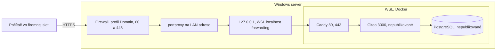

# Bezpečnosť servera

Gitea je zámerne dostupná z firemnej siete, ale iba cez HTTPS. Pred každou zmenou siete si položte otázku: „Vidí to iný počítač vo firme?“

## Sieť



- Docker publikuje iba 80 (presmerovanie na HTTPS) a 443. Gitea 3000, SSH a databáza publikované nie sú.
- `portproxy` počúva iba na LAN adrese servera, nikdy na `0.0.0.0`, a vedie na `127.0.0.1`.
- Pravidlo `Gitea HTTPS` platí iba v profile **Domain**. Mimo firemnej siete sa porty zatvoria.
- Webový sprievodca inštaláciou je vypnutý (`INSTALL_LOCK=true`), `SECRET_KEY` je vlastný.
- Registrácia je vypnutá, účty zakladá administrátor.
- Zmeny firewallu, `portproxy` a portov spúšťa človek, nie automatizácia ani Claude.

Režim WSL `mirrored` by porty WSL zobrazil priamo na rozhraniach Windows. Pred jeho použitím overte dopad a pravidlá Hyper-V firewallu. Overený nie je.

Kontrola na **serveri**, PowerShell:

```powershell
netsh interface portproxy show v4tov4
Get-NetFirewallRule -DisplayName "Gitea HTTPS" | Get-NetFirewallPortFilter | Select-Object LocalPort
Get-NetFirewallRule -DisplayName "Gitea HTTPS" | Select-Object Profile, Enabled
```

V `portproxy` nesmie byť `0.0.0.0` ani port 3000. Z iného počítača musí `Test-NetConnection <meno> -Port 3000` vrátiť `False`.

## Tajomstvá

| Údaj | Kde smie byť | Kde nesmie byť |
|---|---|---|
| `.env` (heslo DB, `SECRET_KEY`, `INTERNAL_TOKEN`) | `~/docker/gitea/.env`, práva 600, šifrovaná záloha | Git, dokumenty, chat |
| Súkromný kľúč certifikátu | `~/docker/gitea/certs/`, trezor IT | Git |
| Heslo administrátora | Správca hesiel | Git, história príkazov |
| IP adresy, mená strojov | Lokálne poznámky | Tento repozitár |

`.gitignore` blokuje `.env`, `certs/`, `*.key`, `*.crt` a `*.bak-*`. Pred commitom:

```bash
git diff --cached | grep -iE "passw|secret|token|bearer"
```

## Certifikát

- `tls internal` je iba na pilot. Koreňový certifikát Caddy sa inštaluje len na pilotné počítače a po prechode na firemnú CA sa odstráni.
- Produkčný certifikát vydáva firemná CA pre presné DNS meno.
