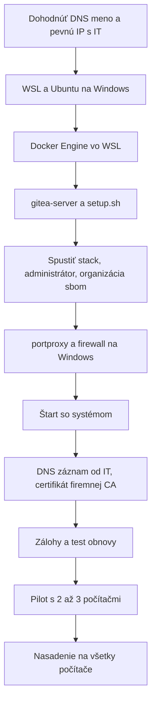

# Nasadenie servera

Gitea pre TIA SBOM Utility na Windows stroji vo firemnej sieti: WSL 2, Ubuntu, Docker Engine, Caddy na 443. Správa a zálohy sú v [sprava.md](sprava.md), sieť a tajomstvá v [bezpecnost.md](bezpecnost.md), chyby v [riesenie-problemov.md](riesenie-problemov.md).

## Čo server potrebuje

| Položka | Požiadavka |
|---|---|
| OS | Windows 10/11 Pro alebo Server, WSL 2, Ubuntu 26.04 LTS |
| Softvér | Docker Engine a Compose plugin vo WSL, nie Docker Desktop |
| Výkon | 2 vCPU, 4 GB RAM pre WSL, 50 GB disk ako začiatok |
| Sieť | Pevná adresa (statická alebo DHCP rezervácia), DNS meno, 443 a 80 z firemnej siete |
| Účet | Jeden Windows účet, pod ktorým beží WSL. Distribúcia WSL patrí jednému používateľovi |
| Čas | NTP |
| Správa | Vlastník, pravidelné aktualizácie OS a obrazov |

Veľkosť je odhad. Jeden SBOM má rádovo desiatky kB, rozhoduje najmä počet verzií a história.

WSL nie je navrhnutý ako server. Riziká sú preto tieto: nespustí sa sám po štarte Windows (rieši to [úloha pri štarte](#7-štart-so-systémom)), aktualizácie Windows reštartujú stroj a adresa WSL sa pri každom štarte mení (rieši to `portproxy` na `127.0.0.1`).

## Postup nasadenia



Konfigurácia je v koreni tohto repozitára:

| Súbor | Účel |
|---|---|
| `docker-compose.yml` | Caddy, Gitea, PostgreSQL. Von ide iba 80 a 443 cez Caddy |
| `Caddyfile` | HTTPS pre `GITEA_DOMAIN`, zatiaľ `tls internal` |
| `.env.example` | Šablóna. Skutočný `.env` vytvorí `setup.sh` |
| `setup.sh` | Skopíruje súbory do `~/docker/gitea`, vygeneruje `.env` s náhodnými heslami, overí konfiguráciu |

Rozdiely oproti vývojovému compose: bez portov 3000 a 2222, SSH vypnuté, `INSTALL_LOCK=true` a vlastný `SECRET_KEY`. Webový sprievodca inštaláciou by bol otvorený celej sieti. Bez `SECRET_KEY` by Gitea použila verejne známu predvolenú hodnotu.

Stav: stack s týmito súbormi bol spustený vo vývojovej WSL ako izolovaný projekt (2026-11-12). Overené sú `healthz` cez Caddy, zamknutý sprievodca, prihlásenie vyžadované pri `REQUIRE_SIGNIN_VIEW=true` a vytvorenie administrátora cez CLI. Kroky 1, 6 a 7 na skutočnom serveri ani export add-inu cez HTTPS overené nie sú.

### 1. WSL a Ubuntu

Na **serveri**, PowerShell **ako správca**:

```powershell
wsl --install --no-distribution
```

Reštart Windows. Potom na **serveri** pod účtom, pod ktorým má Gitea bežať, v bežnom PowerShelli:

```powershell
wsl --list --online
wsl --install -d Ubuntu-26.04
```

Inštalácia sa spýta na používateľa a heslo Linuxu. Over systemd vo **WSL**:

```bash
systemctl is-system-running
```

Výsledok `running` alebo `degraded` je v poriadku. Pri chybe pridaj do `/etc/wsl.conf` sekciu `[boot]` s `systemd=true` a spusti na Windows `wsl --shutdown`.

### 2. Docker Engine

Vo **WSL na serveri**, podľa oficiálneho repozitára Dockeru:

```bash
sudo apt-get update && sudo apt-get install -y ca-certificates curl
sudo install -m 0755 -d /etc/apt/keyrings
sudo curl -fsSL https://download.docker.com/linux/ubuntu/gpg -o /etc/apt/keyrings/docker.asc
echo "deb [arch=$(dpkg --print-architecture) signed-by=/etc/apt/keyrings/docker.asc] https://download.docker.com/linux/ubuntu $(. /etc/os-release && echo "$VERSION_CODENAME") stable" | sudo tee /etc/apt/sources.list.d/docker.list
sudo apt-get update && sudo apt-get install -y docker-ce docker-ce-cli containerd.io docker-buildx-plugin docker-compose-plugin
sudo systemctl enable --now docker
sudo usermod -aG docker "$USER"
```

Na **serveri** v PowerShelli reštartuj WSL, aby platila skupina `docker`:

```powershell
wsl --terminate Ubuntu-26.04
```

Over vo **WSL**:

```bash
docker run --rm hello-world
docker compose version
```

### 3. Súbory a `.env`

Skopíruj obsah repozitára `gitea-server` na server do `C:\tiasbom-server`, napríklad cez zdieľaný priečinok. Ak má server prístup na GitHub, stačí `git clone https://github.com/xsugra/gitea-server.git C:\tiasbom-server`. Potom vo **WSL na serveri**:

```bash
rm -rf ~/tiasbom-server && cp -r /mnt/c/tiasbom-server ~/tiasbom-server
find ~/tiasbom-server -type f -exec sed -i 's/\r$//' {} +
bash ~/tiasbom-server/setup.sh gitea.firma.internal
```

`gitea.firma.internal` nahraď menom, ktoré si dohodol s IT. DNS záznam ešte nemusí existovať. Ak meno ešte nie je dohodnuté, spusti `bash ~/tiasbom-server/setup.sh` bez argumentu. Použije sa plné meno Windows stroja, ktoré AD DNS pozná už teraz. Neskoršia zmena mena je opísaná v [kroku 8](#8-dns-záznam-a-certifikát).

`setup.sh` existujúci `.env` nemení. Heslá nevypisuje. Zálohuj `.env` šifrovane mimo servera.

### 4. Spustenie, administrátor, organizácia

Vo **WSL na serveri**:

```bash
cd ~/docker/gitea
docker compose up -d
docker compose ps
d=$(grep '^GITEA_DOMAIN=' .env | cut -d= -f2)
curl -sk --resolve "$d:443:127.0.0.1" "https://$d/api/healthz"
```

Očakávaný výsledok je `"status": "pass"`. Administrátor, bez hesla v histórii príkazov:

```bash
docker compose exec -u git gitea gitea admin user create --admin --username sbomadmin --email sbomadmin@example.invalid --random-password
```

Vygenerované heslo sa zobrazí raz. Gitea ho pri prvom prihlásení vyžiada zmeniť. Keď funguje [krok 5](#5-sieť-na-windows), založ na webe organizáciu `sbom` (**+ → New Organization**). Token pre add-in: **Settings → Applications → Generate New Token**, oprávnenia *organization* a *repository* Read and Write.

### 5. Sieť na Windows

WSL je v režime NAT, ostatné počítače ho nevidia. Docker porty 80 a 443 sú na Windows dostupné iba na `127.0.0.1` (WSL localhost forwarding, rovnaký mechanizmus ako port 3000 vo vývoji). `portproxy` ich sprístupní na LAN adrese servera. Firewall ich povolí iba v profile **Domain**, teda iba vo firemnej sieti.

Na **serveri**, PowerShell **ako správca**. Spúšťa to človek, nie Claude. Najprv skontroluj vypísanú adresu:

```powershell
$ip = (Get-NetIPConfiguration | Where-Object { $_.IPv4DefaultGateway -and $_.NetAdapter.Status -eq 'Up' } | Select-Object -First 1).IPv4Address.IPAddress
"LAN adresa: $ip"
Get-NetConnectionProfile | Select-Object InterfaceAlias, NetworkCategory
```

`NetworkCategory` na LAN adaptéri musí byť `DomainAuthenticated`. Potom:

```powershell
foreach ($p in 80, 443) {
  netsh interface portproxy delete v4tov4 listenaddress=$ip listenport=$p 2>$null
  netsh interface portproxy add v4tov4 listenaddress=$ip listenport=$p connectaddress=127.0.0.1 connectport=$p
}
Remove-NetFirewallRule -DisplayName "Gitea HTTPS" -ErrorAction SilentlyContinue
New-NetFirewallRule -DisplayName "Gitea HTTPS" -Direction Inbound -Protocol TCP -LocalAddress $ip -LocalPort 80,443 -Profile Domain -Action Allow | Out-Null
Get-Service iphlpsvc | Select-Object Status, StartType
netsh interface portproxy show v4tov4
```

`iphlpsvc` musí bežať a mať štart `Automatic`, inak `portproxy` nefunguje. Pravidlá `portproxy` prežijú reštart. Pri zmene IP ich treba prerobiť, preto je pevná adresa povinná.

Kontrola z **iného počítača** v sieti, PowerShell:

```powershell
Test-NetConnection gitea.firma.internal -Port 443
Test-NetConnection gitea.firma.internal -Port 3000
```

443 musí byť `True`, 3000 `False`. Kým IT nevytvorí DNS záznam, testuj na jednom počítači cez `C:\Windows\System32\drivers\etc\hosts`, riadok s IP servera a menom.

Alternatíva je režim WSL `mirrored` a pravidlo Hyper-V firewallu. Overená nie je, pozri [bezpecnost.md](bezpecnost.md).

### 6. Certifikát počas pilotu

Kým nie je certifikát firemnej CA, Caddy používa vlastnú CA. Prehliadač varuje a add-in spojenie odmietne. Na pilotné počítače preto nainštaluj koreňový certifikát Caddy. Je to zmena dôvery na počítači, vykoná ju človek s vedomím IT.

Vo **WSL na serveri**:

```bash
cd ~/docker/gitea
docker compose cp caddy:/data/caddy/pki/authorities/local/root.crt /mnt/c/tiasbom-server/caddy-root.crt
```

Súbor skopíruj na pilotný počítač do `C:\Temp`. Na **pilotnom počítači**, PowerShell **ako správca**:

```powershell
Import-Certificate -FilePath C:\Temp\caddy-root.crt -CertStoreLocation Cert:\LocalMachine\Root
```

Po prechode na firemnú CA tento certifikát z pilotných počítačov odstráň.

### 7. Štart so systémom

WSL sa po štarte Windows nespustí samo. Úloha Plánovača ho spustí pri štarte a nechá bežať. Docker a kontajnery naštartuje systemd.

Na **serveri**, PowerShell **ako správca**, prihlásený ako používateľ, ktorému patrí distribúcia. Heslo sa zadá do okna, nie do príkazu:

```powershell
$c = Get-Credential -UserName "$env:USERDOMAIN\$env:USERNAME" -Message "Účet, pod ktorým beží WSL"
$a = New-ScheduledTaskAction -Execute "wsl.exe" -Argument "-d Ubuntu-26.04 --exec /bin/sleep infinity"
$t = New-ScheduledTaskTrigger -AtStartup
$s = New-ScheduledTaskSettingsSet -ExecutionTimeLimit ([TimeSpan]::Zero) -RestartCount 3 -RestartInterval (New-TimeSpan -Minutes 1) -AllowStartIfOnBatteries -DontStopIfGoingOnBatteries
Register-ScheduledTask -TaskName "Gitea WSL" -Action $a -Trigger $t -Settings $s -User $c.UserName -Password $c.GetNetworkCredential().Password
```

Over po reštarte servera, bez prihlásenia, z iného počítača cez `Test-NetConnection` z kroku 5. Toto ešte nie je overené.

### 8. DNS záznam a certifikát

Keď IT vytvorí A záznam, over ho na **inom počítači**:

```powershell
Resolve-DnsName gitea.firma.internal
```

Certifikát firemnej CA pre presne toto meno ulož ako `~/docker/gitea/certs/gitea.crt` a `gitea.key`. V `Caddyfile` prepni riadok `tls`. Potom vo **WSL na serveri**:

```bash
cd ~/docker/gitea
chmod 600 certs/gitea.key
docker compose restart caddy
```

Ak sa meno mení, uprav `GITEA_DOMAIN` v `~/docker/gitea/.env` a spusti `docker compose up -d`. Zmeniť treba aj `BaseUrl` v `config.json` na počítačoch.

`REQUIRE_SIGNIN_VIEW=true` znamená, že čitatelia potrebujú účet. Zvážte prihlasovanie cez firemné LDAP alebo AD. Pri `true` vracia aj `/api/v1/version` bez tokenu chybu. Na test dostupnosti použite `/api/healthz`.

