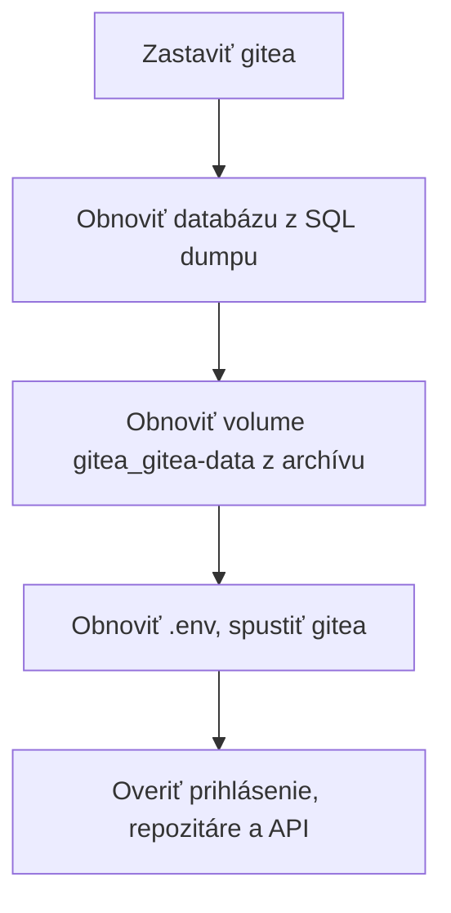

# Správa servera

Všetko sa spúšťa vo **WSL na serveri** v `~/docker/gitea`, ak nie je uvedené inak.

## Bežná správa

```bash
cd ~/docker/gitea
docker compose ps
docker compose logs --tail 100 gitea
docker compose logs --tail 100 caddy
docker compose restart gitea
```

Používatelia:

```bash
docker compose exec -u git gitea gitea admin user list
```

Dostupnosť z WSL, bez DNS:

```bash
d=$(grep '^GITEA_DOMAIN=' .env | cut -d= -f2)
curl -sk --resolve "$d:443:127.0.0.1" "https://$d/api/healthz"
```

## Aktualizácia

### Gitea

1. Urobte [zálohu](#záloha).
2. Prečítajte poznámky k vydaniu.
3. Zmeňte tag obrazu v `docker-compose.yml` v tomto repozitári a commitnite. Nepoužívajte `latest`.
4. Nasaďte súbory podľa [nasadenie.md, krok 3](nasadenie.md#3-súbory-a-env). `setup.sh` existujúci `.env` nezmení a pôvodné súbory zazálohuje ako `*.bak-<čas>`.
5. Spustite:

```bash
cd ~/docker/gitea
docker compose pull gitea
docker compose up -d gitea
docker compose logs --tail 50 gitea
```

### Caddy, PostgreSQL, Ubuntu

```bash
cd ~/docker/gitea
docker compose pull caddy && docker compose up -d caddy
sudo apt-get update && sudo apt-get upgrade -y
```

`postgres:17` neaktualizujte na novú hlavnú verziu bez exportu a importu databázy. Dáta nie sú kompatibilné medzi hlavnými verziami.

## Záloha

Pravidelná záloha zatiaľ nie je nastavená. Ručná záloha do `~/backups`:

```bash
cd ~/docker/gitea
mkdir -p ~/backups
docker compose exec -T db pg_dump -U gitea gitea | gzip > ~/backups/gitea-db-$(date +%F).sql.gz
docker compose stop gitea
docker run --rm -v gitea_gitea-data:/data:ro -v ~/backups:/backup alpine tar czf /backup/gitea-data-$(date +%F).tgz -C /data .
docker compose start gitea
cp docker-compose.yml Caddyfile ~/backups/
ls -la ~/backups
```

Postup je prevzatý z vývojovej inštancie, kde volumes majú rovnaké mená (`gitea_*`).

- `.env` zálohujte oddelene a šifrovane. Bez neho sa obnovená databáza nedá použiť (`SECRET_KEY`).
- Záloha obsahuje tajomstvá z `app.ini`. Zaobchádzajte s ňou ako s heslom.
- Zálohu ukladajte mimo WSL aj mimo servera. Pád distribúcie alebo disku by ju zničil spolu s dátami.

CRA vyžaduje uchovať podklady dlhodobo, počítajte s 10 rokmi:

| Požiadavka | Riešenie |
|---|---|
| Denná záloha | Príkazy vyššie v plánovanej úlohe, zatiaľ nepripravené |
| Mimo server | Firemné úložisko so zálohovaním |
| Test obnovy | Aspoň raz ročne, zapísať výsledok |

## Obnova

Obnova nie je overená. Najprv ju vyskúšajte na testovacom projekte Compose, kým sa na ňu spoľahnete.



## Monitoring

- Dostupnosť `https://<meno>/api/healthz` z iného počítača.
- Voľné miesto na disku Windows aj vo WSL (`df -h /`).
- Výsledok poslednej zálohy.
- Platnosť certifikátu.
- Úloha Plánovača `Gitea WSL` beží.
